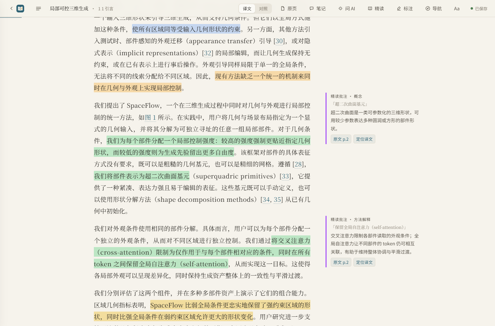
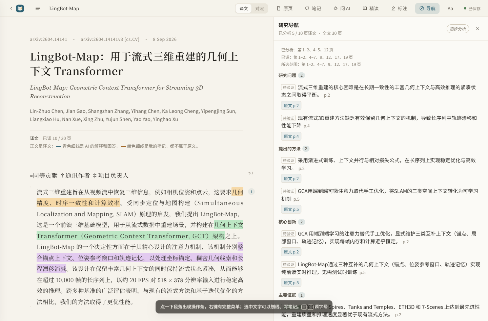
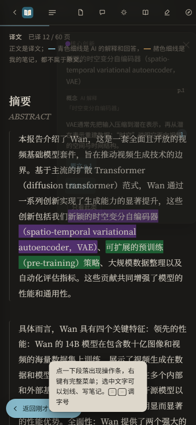

# AI 精读验收报告

## 本轮八类高亮验收（2026-10-13）

本轮基于 `2a4e321f241d966518fe045d6865af4f5ae608d7`，工作分支 `codex/semantic-highlights`。保留任务开始前已有的翻译/手动精读分离改动。代码尚未提交或发布，以下是本次运行证据，不引用历史测试次数作为本轮结果。

实现范围：八类分类、可选重要性/理由、三档密度、分类显示/候选统计、关键结论导航、有界历史候选摘要、可重建的完全重复派生缓存、高亮单条错误隔离。版本仍为 `READING_VERSION=2`；新完成页记录 `prompt_version=1`，质量缓存 `version=1`。人工质量未验收，“重复质控（试验）”默认关闭。

### 本次测试与数据保护

- Python全量：292项通过、0失败、0错误，日志 `artifacts/reading-qa/semantic-unit.log`。基线为215项、8失败、5错误，其中旧流程断言与已有手动精读改动冲突，以及第三方同名tests包抢占导入；已更新等价保护断言并固定本地tests包。
- 浏览器：65项通过、0失败，日志 `artifacts/reading-qa/semantic-browser.log`，覆盖八类、旧数据、三档、零请求、来源跳转、明暗/移动/键盘及质量失效。40页样本各30次切换测得P95：密度21.30ms、类别21.10ms（点击到两帧完成；未作旧版同设备基线对照）。截图在 `tests/shots/reading-semantic-desktop-menu.png`、`reading-semantic-mobile-dark.png`，为隔离测试夹具。
- 端到端：`tests/e2e.cjs` 全部通过；隔离临时文献库覆盖搜索、复制/选择、笔记、人工划线、译文修改、离线续存和移动布局。日志 `artifacts/reading-qa/semantic-e2e.log`。
- 四个UI接线检查通过：reading、deepread、discuss-delete、settings-deepread。
- 独立审查发现并修复两个问题：不可见的保留项不能抑制仍可见的旧候选；高亮 `block_id` 变化必须使派生缓存失效。已先复现失败，再通过对应浏览器和Python回归；日志 `review-red-*` / `review-green-*`。
- 15个原论文 `paper.json` 与准备阶段备份逐字一致；原始译文与存储候选没有被验收脚本改写。运行中的reader/chat变化保持原样，未用备份覆盖用户新操作。记录 `artifacts/reading-qa/paper-preservation.json`。
- 可重现命令：`python -m unittest discover -s tests`、`node --test tests/reading-browser.cjs`、`node tests/reading-ui-check.cjs`。端到端如需指定已有Playwright，设置 `PLAYWRIGHT` 为本地模块路径。

### 固定译文、同模型两页提示词对照

使用现有 OpenAI兼容通道 `claude-haiku-5-5`，LingBot-Map第12、19页。旧臂从起始提交提取提示词；新臂使用最终提示词。两臂共用当前确定性校验、相同原文和固定译文，未重新翻译，也未运行导航综合。随机性使用引擎默认参数、未固定，故这是小样本功能确认，不能当作质量门槛达标。

| 指标 | 旧提示词 | 最终新提示词 |
| --- | --- | --- |
| 保存候选 | 9 | 15 |
| 有重要性评分 | 0 | 15 |
| finding / limitation | 0 / 0 | 5 / 3 |
| 来源校验失败页 | 0 | 0 |
| 精读模型调用 | 1 | 1 |
| 总耗时 | 55.609秒 | 50.609秒 |
| 引擎上报输入+输出Token | 22,196 | 19,843 |
| 译文/公式/表格修改 | 0 | 0 |

最终对照在 `artifacts/reading-qa/semantic-ab-20261013-184526/report.json`。新规则摘要SHA256为 `e24c4a67b195fd23df76b1fc8f7342d08cbf58c4bee27d5a0212651d46589f31`。首轮新臂在提示词最终调整前生成，留档但不作为最终验收；第二轮复用旧臂、只重跑最终新臂。本次真实模型实际共3次调用，无额外模型审阅。调用耗时和用量均保存在副本的 `metrics.jsonl`，未读取或导出凭据。

复现：`python tests/reading_semantic_ab.py --run`（会消耗配置模型额度）；指定 `--reuse-old <report.json>` 可复用同模型同页的旧臂。

### 三篇缓存论文与人工待验收项

`python tests/reading_quality_check.py` 在独立副本上比较相同缓存输出的本地质控，不调用模型。三篇原候选66/78/101条保持不变，当前页面有效且锚点可定位的候选共226条；失败/过时页没有参与抑制。完全重复规则没有找到可确认的重复句，所以本批去重数量为0，不能声称跨章节重复减少30%。近义重复保留给人工复核。

对照记录：`artifacts/reading-qa/semantic-v1/cached-comparison.json`。双人独立复核表：同目录 `human-review.json`，历史有效226条加最终新臂15条，共241条覆盖八类，包含中英文材料、类别与各自必要性/类别/重复/证据判断字段，初始均未填写。finding有5条、limitation有3条，仍需更多样本核查。

仍待验证：至少两位阅读者的金标准、必要性≥85%、分类准确率≥90%、核心召回降幅≤5个百分点、跨章节重复降低≥30%、作者事实严重幻觉0例。F22已检查提示词材料隔离、白名单和伪造来源拒绝；真实模型面对恶意论文指令的行为尚未专项验收。功能回归通过不等于这些人工或对抗指标通过。

### 回滚与兼容

旧六类无需重译；无评分候选各档仍显示。译文/来源变更时旧页面仍失效，质量哈希失配则忽略抑制。关闭“重复质控”或选择“显示重复项”即可恢复重复候选显示；切换密度或类别不产生模型调用。保持翻译/手动精读分离；纯翻译 `reading_enabled=false` 路径仍通过，显式精读保持可手动执行。

准备阶段备份目录：`C:/Users/Axiaoxin/AppData/Local/Temp/easyread-semantic-20261013-182434`。备份只作还原参考，不自动覆盖当前论文、笔记和运行期保存。

最终回归后确认本地服务无活动后台任务、无外部模型连接，已在原地址 `http://127.0.0.1:8765` 重启并取得健康检查200。刷新阅读页即可加载新版；旧候选仍兼容，手动重做精读才会生成新两类和评分。

---

## 历史六类验收（以下记录属于2026-10-12）

记录日期：2026-10-12。四阶段已分别提交，回归与真实论文抽检结果如下。

## 修改说明

| 阶段 | 提交 | 主要内容 |
| --- | --- | --- |
| 一 | `b4f31ea` | 原文块稳定 ID 与坐标、翻译同批返回六色高亮、前端高亮渲染与筛选 |
| 二 | `2ee8987` | 精读批注、独立页面状态、补精读命令、版本失效与失败降级 |
| 三 | `3ad062e` | 研究要点提取、全文研究导航、覆盖范围与完成状态 |
| 四 | `ce68a03`、`047cef1` | 提示词质量约束、跨栏分块修复、导读覆盖过滤、用量统计、真实论文验收 |

新增文件：`easyread/reading.py`、`easyread/sourceblocks.py`、`docs/reading.md`、`docs/reading-acceptance.md`、`docs/reading-sample.json`，以及 `tests/` 下的精读单元、集成、前端与验收测试。

数据变化：`paper.json` 增加 `reading`（页面状态、要点、版本绑定）与 `reading_guide`（导航、覆盖范围、综合结论）。旧论文无这些字段时照常阅读，用 `enrich` 补精读。

## 自动化测试

- `.venv\Scripts\python.exe -m unittest discover -s tests`：216 项通过，0 失败。
- `node tests\reading-browser.cjs`：37 项通过。
- `node tests\e2e.cjs`：全部通过。
- `node tests\reading-ui-check.cjs`、`deepread-ui-check.cjs`、`discuss-delete-check.cjs`、`settings-deepread.cjs`：通过。

## 样例成果

[reading-sample.json](reading-sample.json) 是 SpaceFlow 第 2 页的真实产出节选，含中英对照、六色高亮、批注与依据、论文级要点和研究导航。`tests/test_reading_sample.py` 用产品自身的校验器检查这个样例，代码演进导致样例失效时测试会失败。

界面效果（真实论文，`docs/images/`）：

完整截图（每篇论文 4 张：正文、批注弹窗、研究导航、深色移动端）在 `artifacts/reading-qa/screenshots/`。

## 真实论文抽检

三篇英文论文，共 30 页抽样，覆盖引言、相关工作、方法、实验、局限与公式密集页。
副本写入被忽略的 `artifacts/reading-qa`，`library/` 原文 paper.json 与 PDF 的 SHA256 与抽检前一致，译文零改动。

使用 Codex CLI（gpt-6-luna）通过 `tests/reading_real.py enrich --all` 生成。结构校验结果：28 页完成，SpaceFlow 第 5、6 页因来源引文无法在原文逐字定位而失败，译文保留，其余标注丢弃。

真实页面截图：三篇全部通过（高亮渲染、筛选、批注弹窗、研究导航跳转、深色移动端布局）。

语义质量由模型辅助逐条审阅，完整记录见 `artifacts/reading-qa/*-semantic-codex.json`：

| 论文 | 高亮分类 | 高亮必要 | 批注必要/来源支持 | 洞见支持 | 严重幻觉 |
| --- | --- | --- | --- | --- | --- |
| SpaceFlow（8 页，completed 6 页） | 97.9% | 93.6% | 88.9% / 88.9% | 100% | 0 |
| LingBot-Map（10 页，全部完成） | 96.2% | 80.8% | 72.7% / 100% | 100% | 0 |
| WAN（12 页，全部完成） | 91.1%（严格）/ 97.0%（宽松） | 6 条引文信息量不足 | — | 32/34 严格支撑 | 0 |

LingBot-Map 由主代理逐条阅读补做：78 条高亮、11 条批注、21 条洞见全部覆盖，引文 42/42 在原文中逐字命中，表 8 的 1.7×/2.7× 与表 6、第 12 页的 AUC/ATE 数值均已核对。三篇审阅都不是人工审核，不能替代人工确认。

审阅发现的问题及处理：

- 已修复（代码）：导读不再引用失败页残留的洞见，跨页关系与核验同步过滤。
- 已修复（提示词）：跨段落推断必须标 provisional；引言、概述与结论重复内容只标一处；引文不得在公式或从句中途截断；本文自身的局限归 limitation 而不是 problem；跨页重复的洞见不重复提取。
- 未验证：提示词改动发生在额度耗尽之后，没有再跑一次真实模型确认必要性是否从 80.8% 回升。LingBot-Map 的 80.8% 主要由跨章节重复高亮造成，是当前最明确的下一步优化点。

### 提示词改动的验证

Claude Code 与 Codex 额度耗尽后，改用配置里已有的 OpenAI 兼容通道（deepseek-v4-pro）。同一模型、同一篇论文、同一批第 2、5、7、9 页，只有提示词不同：

| | 高亮 | 跨页重复高亮 | 批注 | 洞见 |
| --- | --- | --- | --- | --- |
| 旧提示词 | 37 | 2 | 6 | 10 |
| 新提示词 | 27 | 0 | 2 | 5 |

新提示词的 27 条高亮没有残句也没有跨页重复；逐条看过去，p9-3 的采样策略改为 method 而非 background，引言/方法/结论重复的“三类上下文”只保留了一处。仍有两处可改：p5-4 与 p7-1 都标了相对位姿损失，属轻度重复（度量脚本按三元组重合度判定，这两条措辞差异大未被计入）；p9-9 保留了“不引入额外误差”这类较强的作者 claim，丢掉了更有价值的长度上限那条。

对照脚本见 `tests/reading_measure.py`。它对我人工判定的旧产物独立复现了同一批问题（5 条残句、2 组跨页重复），可作为后续回归的客观指标。

另一组不可比的数据：改动前用 gpt-6-luna 跑同样的 4 页得到 49 条高亮，改动后用 deepseek-v4-pro 得到 27 条。这两个数受模型影响，只说明方向，不能当作提示词改动的净收益。

## 性能

同模型、同两页样本对照：

| 模式 | 模型调用 | Token | 耗时 |
| --- | --- | --- | --- |
| 纯翻译 | 1 | 52,049 | 107.6 秒 |
| 翻译＋精读 | 2（含 1 次局部修复） | 61,537 | 168.8 秒 |

Token 1.18 倍，耗时 1.57 倍，均在 1.6 倍与 1.8 倍目标内。成功批次不产生额外页面级调用；额外调用只在校验失败时做一次局部修复。

Codex CLI 用量来自 JSONL 的 `turn.completed`，缓存 token 不重复累加；任一轮缺失或损坏用量时整次用量记为空，不上报会低估成本的部分合计。引擎未上报用量时同样保留为空，不当作零成本。

## 可观测性

`job.log` 逐批记录高亮、批注、研究要点的校验错误数与失败页。`metrics.jsonl` 记录正常翻译、手动精读、局部修复、综合四类调用的引擎、模型、耗时与用量。余额不足会停止尚未启动的批次，不产生重复计费调用。

## 已知限制

- 本轮所有语义审阅都由模型完成，任务书要求的人工抽检尚未进行；分类 90%、必要性 85%、零严重幻觉的门槛未经人工确认。
- 创新类高亮判定、背景要点提取与本轮去重/截断约束的提示词改动发生在额度耗尽之后，没有再跑一次真实模型验证其效果。
- 极少数页面的来源引文无法逐字定位，整页精读会失败并跳过，译文不受影响，重试后可恢复。
- 已有旧译文问题（例如缺图注）仍需单独修复，不在精读改造范围内。
- Codex CLI 的模型目录来自本机配置，模型或目录升级可能需要重新验证。

## 关闭与回滚

- 翻译与精读分开：翻译不触发 AI 标注；用户从阅读页“标注”面板或运行 `python -m easyread enrich PAPER_ID` 手动精读，默认重跑全部已译页。
- 指定范围：`python -m easyread enrich PAPER_ID --pages 3-5`；`--all` 保留为显式重跑全篇的兼容参数。
- 原文变化：重新 prepare 后使用 enrich 补处理，旧定位与精读自动失效，无须重译。
- 精读数据保存在 `paper.json`，不改译文；重译页面后对应的旧精读标注自动失效。
